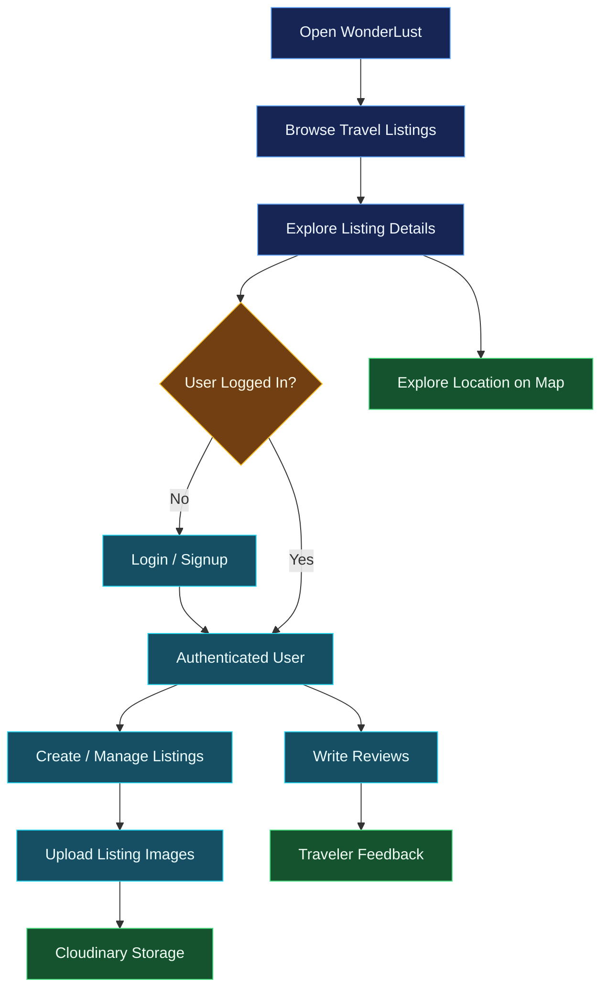
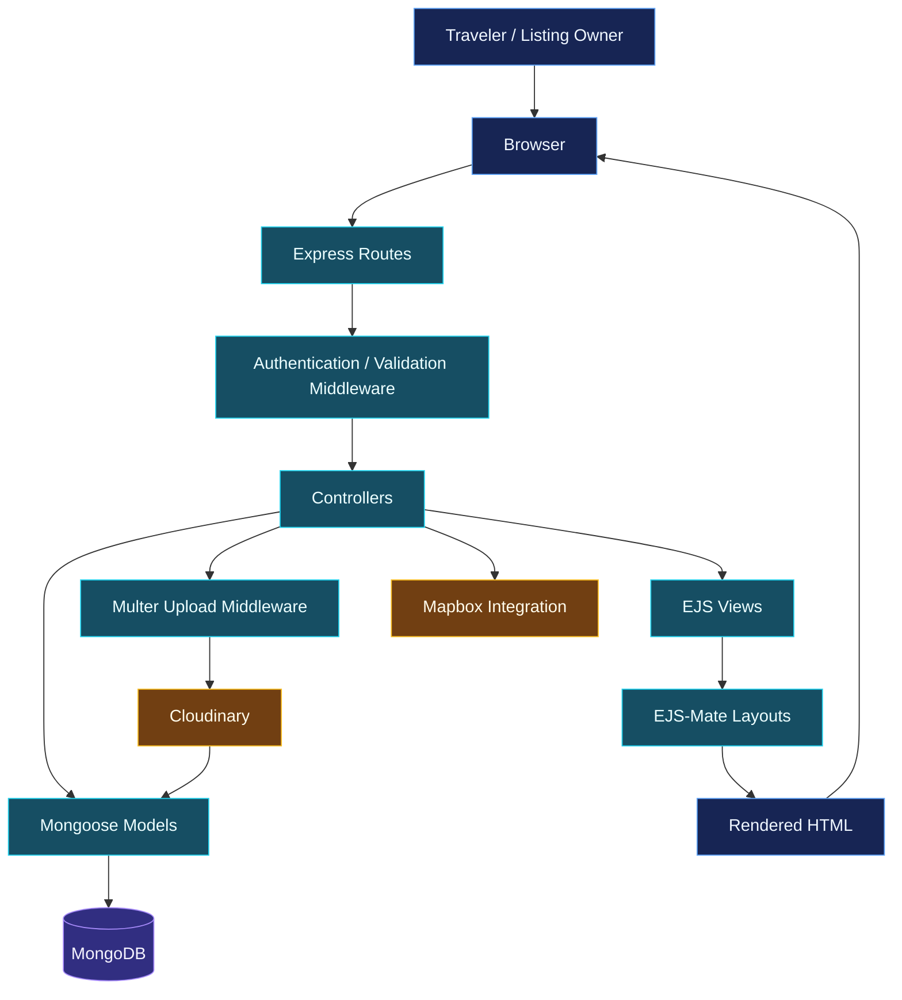
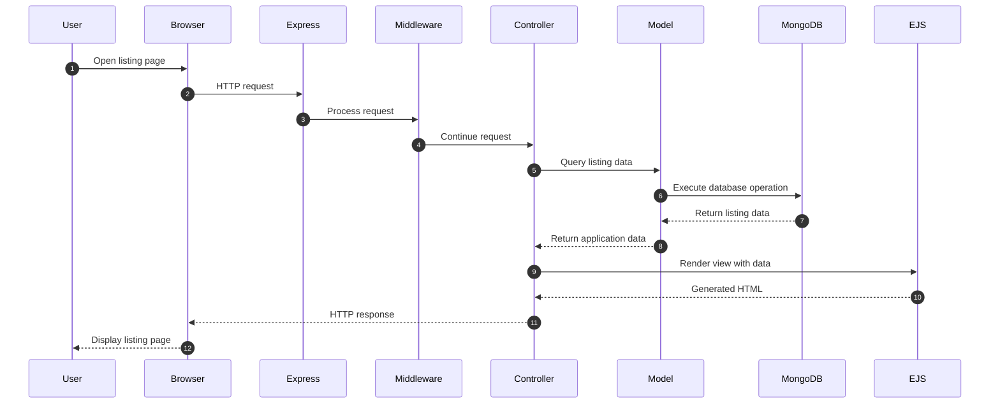
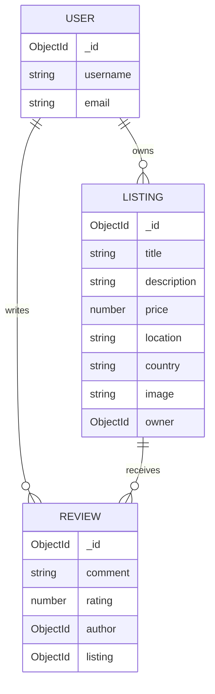
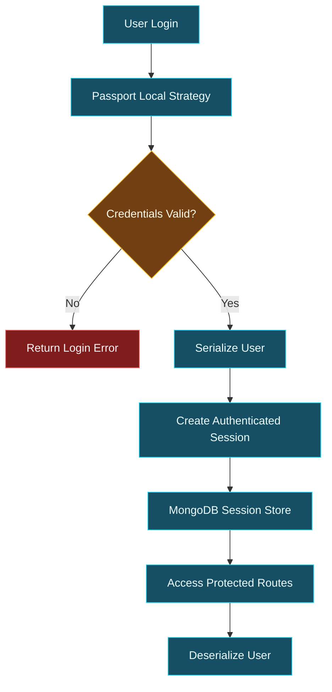

 <div align="center">


<br/>

<p>
<strong>A full-stack travel listing platform that brings destination discovery, accommodation listings, and traveler experiences together.</strong>
</p>

<p>


</p>

<p>


</p>

<em>Find remarkable places. Explore unique stays. Share the experience.</em>

<br/><br/>

<a href="https://wonderlust-1-8csq.onrender.com/listings">

</a>

<br/><br/>

<sub>✦ A journey begins with a destination. ✦</sub>

</div>

---

## `~/destination` — What is WonderLust?

**WonderLust** is a full-stack travel listing web application designed to help users discover places, explore accommodation listings, and share their experiences.

Inspired by modern travel and accommodation platforms, the application allows users to browse available listings, publish their own properties, upload images, and interact with other travelers through reviews.

Built with **Node.js, Express.js, MongoDB, and EJS**, WonderLust uses server-side rendering and MVC architecture to organize its application logic.

> **The idea:** Turn destination discovery into a connected experience where people can explore places, publish stays, and share their journeys.

<details>
<summary><strong>Project highlights</strong></summary>

| Area | Implementation |
|---|---|
| Application type | Full-stack travel listing platform |
| Rendering | Server-side rendering with EJS |
| Architecture | Model-View-Controller |
| Backend | Node.js + Express.js |
| Database | MongoDB + Mongoose |
| Authentication | Passport.js + Express Session |
| Image storage | Cloudinary |
| Maps | Mapbox |
| Deployment | Render |

</details>

## `~/the-journey` — The Problem

Discovering a place to stay involves more than browsing photographs. Travelers need useful listing information, location context, and experiences shared by other people.

At the same time, property owners need a way to publish and manage their listings.

WonderLust brings these interactions into a single web application.

- **Discover:** Browse travel and accommodation listings.
- **Publish:** Create and manage property listings.
- **Explore:** View detailed information about a destination.
- **Experience:** Share reviews and ratings.
- **Visualize:** Explore listing locations through map integration.
- **Connect:** Access the platform through authenticated user accounts.

## `~/explore` — Application Journey



## `~/architecture` — System Architecture

WonderLust follows the **MVC (Model-View-Controller)** pattern.

The browser requests a page from the Express server. Routes direct requests to the relevant application logic, controllers handle operations, models interact with MongoDB, and EJS templates render dynamic HTML responses.



### The MVC design

| Layer | Responsibility | WonderLust implementation |
|---|---|---|
| **Model** | Data structure and database interaction | Mongoose models |
| **View** | User-facing presentation | EJS templates |
| **Controller** | Application and business logic | Controller modules |
| **Routes** | HTTP request routing | Express Router |
| **Middleware** | Authentication, validation, and shared request processing | Custom middleware |

### Why EJS?

WonderLust uses **Embedded JavaScript (EJS)** instead of a client-side React application.

EJS allows the server to render HTML dynamically using application data.

For example, listing information retrieved from MongoDB can be passed to an EJS template and displayed directly in the generated page.

This approach provides:

- Dynamic server-rendered pages.
- Reusable template layouts and partials.
- Direct integration with Express routes.
- Server-side rendering of listing information.
- A straightforward way to separate presentation from backend logic.

`ejs-mate` provides reusable layouts and template composition.

## `~/features` — Explore the Platform

### 01 / Travel Listings

The core of WonderLust is its listing system.

Users can explore available listings and access detailed pages containing the information associated with each property.

- Browse all available listings.
- View individual listing details.
- Create new listings.
- Edit existing listings.
- Delete listings.

### 02 / Authentication

WonderLust uses Passport.js with the local authentication strategy.

The application integrates authentication with Express Session to maintain user login state.

- User registration.
- Login and logout.
- Passport Local authentication.
- User serialization and deserialization.
- Session persistence through MongoDB.

### 03 / Listing Ownership

Listing operations are protected through application middleware and authorization logic.

This separates the ability to access a resource from the permission to modify it.

- Restrict protected listing operations.
- Associate listings with their owners.
- Protect owner-specific modification workflows.

### 04 / Reviews and Ratings

Travelers can share feedback about listings through the review functionality.

- Submit listing reviews.
- Associate reviews with listings.
- Display reviews with listing details.
- Support review-related operations.

### 05 / Cloud Image Management

Listing images are uploaded through Multer and stored using Cloudinary integration.

This separates image storage from the application's local server environment.

- Handle image uploads.
- Integrate Cloudinary storage.
- Store image information with listing data.
- Render hosted images in listing pages.

### 06 / Interactive Maps

WonderLust integrates Mapbox to provide location-based visualization for listings.

This adds geographical context to the listing experience and helps users understand where a property is located.

### 07 / Flash Messages and Error Handling

The application uses Connect Flash to communicate operation results to users.

Custom error handling and middleware provide a centralized approach to handling unsuccessful requests.

## `~/request-lifecycle` — From Browser to Database



## `~/data-models` — Database Relationships

WonderLust uses MongoDB with Mongoose to manage application data.

The platform's data relationships connect users, travel listings, and reviews.



<sub>Conceptual relationship diagram showing the main domain entities; refer to the Mongoose schemas for the exact fields and references.</sub>

## `~/technology` — Technology Ecosystem

### Frontend and templating

| Technology | Purpose |
|---|---|
| HTML5 | Page structure |
| CSS3 | Styling |
| Bootstrap | Responsive UI components |
| JavaScript | Client-side interactions |
| EJS | Dynamic server-side HTML rendering |
| EJS-Mate | Reusable layouts and template composition |

### Backend and database

| Technology | Purpose |
|---|---|
| Node.js | JavaScript runtime |
| Express.js | Web application framework |
| MongoDB | Document-oriented database |
| Mongoose | MongoDB object modeling |

### Authentication and application services

| Technology | Purpose |
|---|---|
| Passport.js | Authentication |
| Passport Local | Username/password strategy |
| Passport Local Mongoose | User authentication integration |
| Express Session | Session management |
| Connect Mongo | MongoDB-backed session storage |
| Connect Flash | User feedback messages |
| Joi | Input validation |
| Method Override | PUT and DELETE method support in forms |

### Cloud integrations

| Technology | Purpose |
|---|---|
| Cloudinary | Image storage and delivery |
| Multer | Multipart form and image upload handling |
| Multer Storage Cloudinary | Cloudinary storage integration |
| Mapbox | Interactive maps and location visualization |

## `~/project-structure` — Codebase Organization

WonderLust organizes the application into distinct MVC-oriented modules.

```text
WonderLust/
│
├── controllers/
│   ├── listings.js
│   ├── reviews.js
│   └── users.js
│
├── models/
│   ├── listing.js
│   ├── review.js
│   └── user.js
│
├── routes/
│   ├── listings.js
│   ├── reviews.js
│   └── user.js
│
├── views/
│   ├── layouts/
│   ├── includes/
│   ├── listings/
│   └── users/
│
├── public/
│   ├── css/
│   ├── js/
│   └── assets/
│
├── uploads/
├── init/
├── utils/
│   ├── ExpressError.js
│   └── wrapAsync.js
│
├── cloudConfig.js
├── middleware.js
├── schema.js
├── app.js
├── package.json
└── README.md
```

*The tree illustrates the application's logical MVC organization. Verify individual filenames and nested directories against the current repository before treating it as an exact file inventory.*

## `~/security` — Authentication and Validation

WonderLust separates authentication, authorization, and request validation into dedicated application responsibilities.

### Authentication workflow



### Security considerations

- Protect authenticated routes.
- Verify listing ownership before allowing modifications.
- Validate incoming listing and review data.
- Store session data in MongoDB.
- Keep database and cloud credentials in environment variables.
- Avoid exposing private configuration values in version control.

## `~/getting-started` — Run Locally

### Prerequisites

- Node.js `20.19.6`
- npm
- MongoDB Atlas or a MongoDB instance
- Cloudinary account
- Mapbox access token

### 01 / Clone the repository

```bash
git clone https://github.com/Sarthaktanpure/WonderLust.git

cd WonderLust
```

### 02 / Install dependencies

```bash
npm install
```

### 03 / Configure environment variables

Create a `.env` file in the root directory.

```env
MONGO_URL=your_mongodb_connection_string

SECRET=your_session_secret

CLOUD_NAME=your_cloudinary_name
CLOUD_API_KEY=your_cloudinary_api_key
CLOUD_API_SECRET=your_cloudinary_api_secret

MAP_TOKEN=your_mapbox_token
```

Keep the `.env` file private. Never push real credentials to GitHub.

### 04 / Start the application

```bash
npm start
```

Alternatively, during development:

```bash
npx nodemon app.js
```

### 05 / Open WonderLust

```text
http://localhost:8080/listings
```

<details>
<summary><strong>Application configuration notes</strong></summary>

- The application connects to MongoDB using `MONGO_URL`.
- Express listens on port `8080`.
- EJS is configured as the view engine.
- EJS-Mate is configured for template layouts.
- Express sessions use MongoDB-backed storage.
- Passport Local handles authentication.

</details>

## `~/deployment` — Live Application

<box>

**<a href="https://wonderlust-1-8csq.onrender.com/listings">Explore WonderLust — Live Application</a>**

<caption>Hosted on Render.</caption>

</box>

The deployed application is available at:

https://wonderlust-1-8csq.onrender.com/listings

## `~/engineering-decisions` — What This Project Demonstrates

| Engineering concept | Practical implementation |
|---|---|
| MVC architecture | Separation of models, views, and controllers |
| Server-side rendering | Dynamic EJS templates |
| RESTful routing | Express route organization |
| Database relationships | Mongoose references between application entities |
| Authentication | Passport Local |
| Session persistence | Express Session + Connect Mongo |
| Authorization | Ownership and protected-route middleware |
| Input validation | Joi |
| Image uploads | Multer + Cloudinary |
| Map integration | Mapbox |
| Error handling | Custom error classes and async wrappers |

### Why server-side rendering?

Using EJS provided practical experience with server-rendered web applications.

Instead of sending a separate frontend application that requests all page data after loading, Express can retrieve the required information and render a complete HTML response.

This makes the request lifecycle explicit and provides a clear connection between routing, controllers, database queries, and presentation.

## `~/roadmap` — Future Possibilities

Potential improvements that can extend the platform:

| Enhancement | Status |
|---|---|
| Advanced destination search and filtering | Future improvement |
| Wishlist and favorite listings | Future improvement |
| Booking and reservation workflow | Future improvement |
| Payment gateway integration | Future improvement |
| User profile dashboard | Future improvement |
| Email notifications | Future improvement |
| Advanced listing discovery | Future improvement |
| Automated unit and integration testing | Future improvement |

<details>
<summary><strong>Engineering checklist</strong></summary>

- [x] Express application setup
- [x] EJS server-side rendering
- [x] EJS-Mate layout integration
- [x] MongoDB connection with Mongoose
- [x] MVC-oriented application structure
- [x] Listing CRUD workflows
- [x] Passport Local authentication
- [x] Express Session integration
- [x] MongoDB-backed session storage
- [x] Listing and review functionality
- [x] Cloudinary image integration
- [x] Mapbox integration
- [x] Joi validation
- [x] Custom error handling
- [ ] Automated test suite
- [ ] Booking and reservation workflow
- [ ] Payment gateway integration
- [ ] Wishlist functionality

</details>

## `~/lessons` — Engineering Takeaways

Building WonderLust provided practical experience in:

- Designing an MVC-based full-stack application.
- Understanding the EJS templating engine.
- Building server-rendered pages with Express.
- Implementing CRUD operations.
- Managing MongoDB relationships with Mongoose.
- Implementing authentication using Passport.js.
- Managing persistent sessions with MongoDB.
- Uploading and serving cloud-hosted images.
- Integrating interactive maps.
- Structuring middleware and error handling.
- Deploying a Node.js application.

More importantly, the project demonstrates how multiple backend components work together to deliver a complete web application.

---

<div align="center">

**WonderLust — the world is full of places worth discovering.**

<br/>

<em>Find your next destination. Explore a different perspective. Make every journey memorable.</em>

<br/><br/>

<sub>Designed and developed by
<a href="https://github.com/Sarthaktanpure">Sarthak Tanpure</a></sub>

<br/><br/>


</div>
